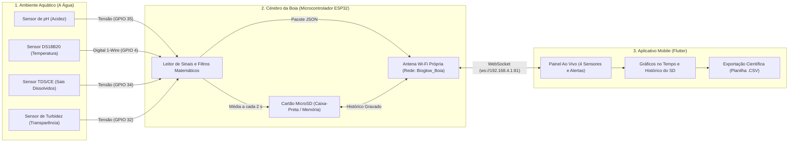
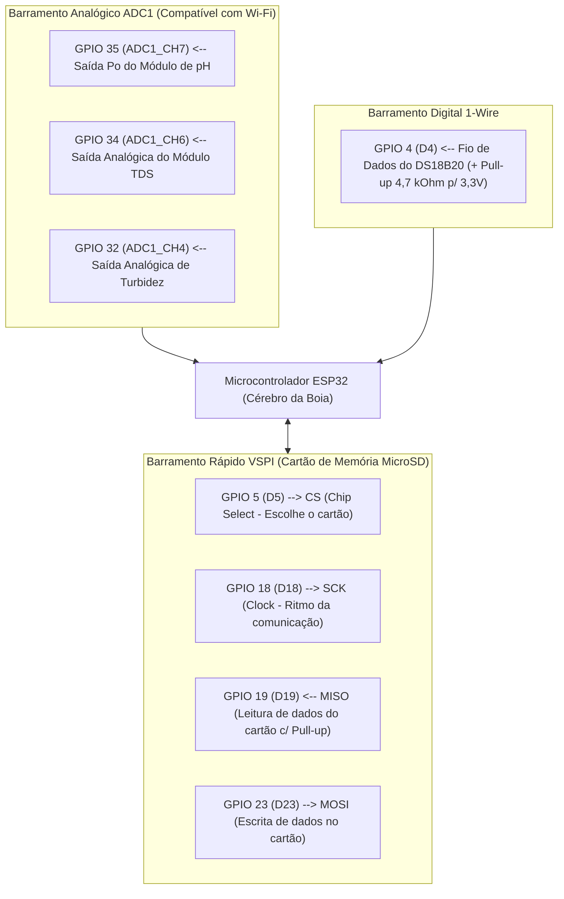
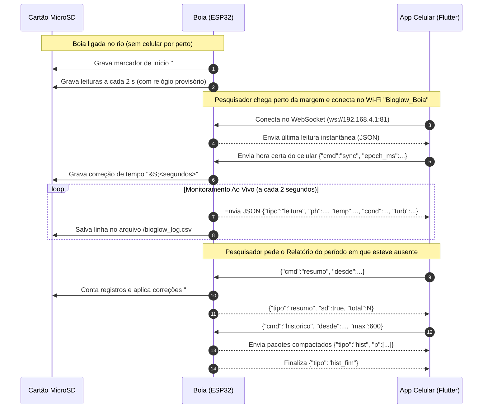
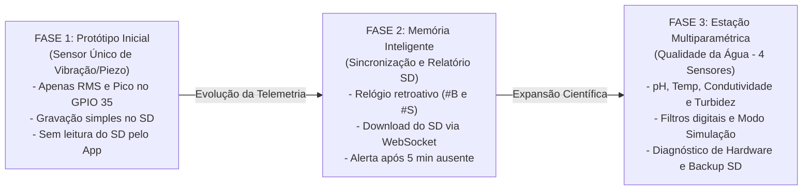
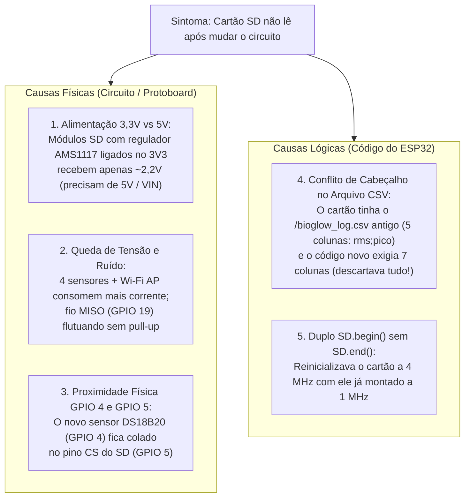

# 🌊 Documentação Tecnológica — Projeto BioGlow (Estação Boia HidroBô)

> [!NOTE]
> **Propósito deste documento:** Apresentar de forma **profissional, técnica e ao mesmo tempo didática** (acessível para estudantes do **6º, 7º e 8º ano do Ensino Fundamental**) toda a engenharia por trás da boia inteligente **BioGlow / HidroBô**, incluindo seus sensores, comunicação sem fio, evolução tecnológica e os desafios reais de hardware e software solucionados durante o desenvolvimento.

---

## 1. Visão Geral: Como a Boia Funciona?

Imagine que um rio, lago ou represa é como um organismo vivo. Para saber se a água está saudável para os peixes, plantas e seres humanos, não basta olhar para ela uma única vez: precisamos medir seus **sinais vitais** continuamente, de dia e de noite.

A **Boia BioGlow (HidroBô)** é um **laboratório flutuante automatizado**. Ela fica na água coletando medidas a cada fração de segundo, guarda tudo em um cartão de memória e transmite os resultados pelo ar (via Wi-Fi próprio) diretamente para um aplicativo de celular ou tablet.

---

## 2. Os "Quatro Sentidos" da Boia (Sensores e Engenharia)

Para entender a qualidade da água, a boia utiliza **4 sensores científicos** ligados ao microcontrolador **ESP32** (o computador em miniatura dentro da boia):

| Sensor | O que ele mede? *(Explicação 6º ao 8º ano)* | Como funciona na Engenharia? *(Detalhe Técnico)* | Pino no ESP32 | Faixa Ideal |
| :--- | :--- | :--- | :---: | :---: |
| **1. pH da Água** | Mede se a água está **ácida** (como limão, pH baixo), **neutra** (pH 7) ou **básica/alcalina** (como sabão, pH alto). Peixes precisam de água próxima do neutro. | Sonda eletroquímica BNC que gera uma tensão elétrica proporcional aos íons $H^+$. Em pH 7,0 a referência é `2,500 V`, variando `~0,18 V` por unidade de pH. | **GPIO 35** (`ADC1_CH7`) | **6,5 a 8,5 pH** |
| **2. Temperatura (DS18B20)** | Mede o **calor da água** em graus Celsius (°C). Água muito quente perde oxigênio dissolvido e sufoca a vida aquática. | Sensor digital blindado à prova d'água que conversa em código binário pelo protocolo **1-Wire** (precisa de um resistor *pull-up* de `4,7 kΩ` entre dados e `3,3 V`). | **GPIO 4** (`1-Wire`) | **15,0 a 30,0 °C** |
| **3. Condutividade / TDS** | Mede a quantidade de **sais, minerais ou poluentes dissolvidos** que não conseguimos ver a olho nu, testando o quão fácil a eletricidade passa pela água. | Mede a condutância elétrica da água. Como a temperatura altera a agitação dos íons, o código usa a temperatura do DS18B20 para **compensar matematicamente** o valor para 25 °C. | **GPIO 34** (`ADC1_CH6`) | **50 a 1500 µS/cm** |
| **4. Turbidez** | Mede o quão **turva ou barrenta** está a água (folhas, barro, algas ou esgoto bloqueando a luz do sol que as plantas aquáticas precisam). | Emite um feixe de luz infravermelha através da água e mede quanta luz chega ao receptor do outro lado. Água limpa deixa passar mais luz (`>= 2,50 V` = `0 NTU`). | **GPIO 32** (`ADC1_CH4`) | **< 40 NTU** |

### Mapa Completo de Conexões Elétricas (Pinagem do ESP32)

---

## 3. Comunicação Sem Internet e a "Caixa-Preta" (Cartão SD)

Em uma represa ou rio afastado da cidade, **não existe sinal de internet ou roteador Wi-Fi**. Como o celular conversa com a boia e como os dados não se perdem quando os pesquisadores vão embora?

### 3.1. A Própria Boia é o Roteador Wi-Fi (*Access Point*)
- O ESP32 cria sua própria rede Wi-Fi chamada **`Bioglow_Boia`** (endereço fixo `192.168.4.1`).
- Dentro dessa rede, funciona um canal de alta velocidade chamado **WebSocket** na porta `81` (`ws://192.168.4.1:81`).
- **Analogia:** Enquanto a internet comum funciona como enviar cartas (você pede uma página e espera a resposta), o **WebSocket** funciona como uma **chamada de telefone aberta**: a cada `2 segundos`, a boia fala automaticamente os valores de todos os sensores para o celular!

### 3.2. O Segredo do Relógio Sem Bateria (`#B` e `#S`)
O ESP32 não tem uma bateria de relógio interno (quando ele desliga, "esquece" que dia é hoje). Se a boia for ligada no meio do lago às 06h00 da manhã sem nenhum celular por perto, como ela sabe a hora certa de cada medida?

> [!TIP]
> **Solução de Engenharia (Sincronização Retroativa):**
> 1. **Ao ligar (`#B` - Boot):** A boia escreve uma marca `#B` no cartão SD e começa a contar o tempo usando um cronômetro interno provisório.
> 2. **Quando o celular conecta (`#S` - Sync):** O aplicativo envia imediatamente a hora real do relógio do celular (`cmd: "sync"`).
> 3. **Cálculo Mágico:** O ESP32 calcula a diferença (em segundos) entre o cronômetro provisório e a hora real do celular, grava `#S;<diferenca>` no cartão SD e corrige automaticamente a data e a hora de todas as leituras feitas antes de o celular chegar!

---

## 4. Linha do Tempo: A Evolução do Projeto

O projeto passou por **três grandes gerações tecnológicas** até chegar ao sistema multiparamétrico atual:

| Característica | Fase 1 (Piezo Inicial) | Fase 2 (Histórico Inteligente) | Fase 3 Atual (Estação Qualidade da Água) |
| :--- | :--- | :--- | :--- |
| **Sensores** | 1 sensor (Vibração Piezo no GPIO 35) | 1 sensor (Vibração Piezo) | **4 sensores** (pH, Temperatura, Condutividade, Turbidez) |
| **Colunas no Cartão SD** | `data;hora;rms;pico` | `epoch;data;hora;rms;pico` (5 colunas) | `epoch;data;hora;ph;temp;cond;turb` (**7 colunas**) |
| **Correção de Horário** | Não possuía (hora fixa simulada) | Marcadores `#B` e `#S` automáticos | Marcadores `#B` e `#S` + migração automática de arquivo antigo |
| **Recursos do Aplicativo** | Gráfico simples ao vivo | Alerta de ausência (≥ 5 min) + Relatório SD | **Painel 4 sensores**, faixas ideais configuráveis, Simulador Científico e Exportação `.CSV` |

---

## 5. Diário de Engenharia: Problemas Enfrentados e Como Resolvemos

Na engenharia real, quando mudamos um circuito ou evoluímos um projeto, surgem **desafios físicos e lógicos**. Abaixo estão os **4 grandes problemas reais** que enfrentamos e como cada um foi diagnosticado e solucionado:

---

### 🛠️ Problema 1: O Conflito entre a Antena Wi-Fi e os Pinos dos Sensores (`ADC2` vs `ADC1`)
- **O que acontecia (Explicação simples):** O ESP32 tem duas "portas de entrada" para ler sensores analógicos: o bloco `ADC1` e o bloco `ADC2`. Porém, a antena Wi-Fi do ESP32 usa o mesmo circuito interno do `ADC2`. Quando o Wi-Fi ligava, qualquer sensor conectado no `ADC2` (como o antigo pino `GPIO 27`) parava de funcionar!
- **Solução Técnica:** Mapeamos todos os sensores analógicos exclusivamente para o barramento **`ADC1`** (**pH no `GPIO 35`**, **TDS no `GPIO 34`** e **Turbidez no `GPIO 32`**), que funciona de forma independente mesmo com o Wi-Fi em potência máxima. Já o sensor de temperatura no `GPIO 4` usa comunicação **digital** (`1-Wire`), não sofrendo bloqueio do `ADC2`.

---

### 🛠️ Problema 2: O Cartão SD Parou de Ler Após a Mudança para o Novo Circuito
Quando o circuito na protoboard mudou de 1 sensor para 4 sensores, o cartão SD deixou de responder e o histórico ficava zerado. Nossa investigação revelou **causas físicas (elétricas)** e **causas de software**:

> [!IMPORTANT]
> **Como foi resolvido:**
> 1. **No código ([`bioglow_boia.ino`](file:///C:/Flutter%20Apps/bioglow_transmissor/bioglow_receptor/esp32/bioglow_boia/bioglow_boia.ino#L190-L248)):**
>    - Ativamos o resistor interno `INPUT_PULLUP` no pino `MISO (GPIO 19)` para estabilizar o sinal na protoboard.
>    - Criamos um **sistema de redução automática de velocidade (*fallback*)**: tenta conectar em `4 MHz`; se houver ruído nos fios da protoboard, reduz automaticamente para `1 MHz` e `400 kHz` (com `SD.end()` correto entre as tentativas).
>    - **Migração automática de arquivo:** Se o ESP32 encontra um `/bioglow_log.csv` antigo de 5 colunas (`rms;pico`), ele faz backup automático para `/bioglow_log_piezo_bkp.csv` e cria uma tabela nova de 7 colunas (`epoch;data;hora;ph;temp;cond;turb`).
> 2. **Ferramenta criada:** Sketch de bancada [`teste_sd_diagnostico.ino`](file:///C:/Flutter%20Apps/bioglow_transmissor/bioglow_receptor/esp32/teste_sd_diagnostico/teste_sd_diagnostico.ino) para testar curto nos pinos e velocidades SPI passo a passo.

---

### 🛠️ Problema 3: Diagnóstico do Sensor de Temperatura DS18B20 (`-127 °C` e `85 °C`)
- **O que acontecia:** Na montagem em protoboard, o sensor digital DS18B20 pode apresentar dois números "mágicos" que na verdade são códigos de erro de fábrica:
  - **`-127,00 °C`:** Significa que a linha de dados (`GPIO 4`) ficou muda — fio solto ou falta do resistor de *pull-up* de `4,7 kΩ` entre o pino `GPIO 4` e o `3,3V`.
  - **`85,00 °C`:** É o valor que o sensor carrega ao ligar, antes de conseguir medir a temperatura. Se ele trava em `85 °C`, significa que o fio vermelho (`VCC 3,3V`) está com mau contato (alimentação parasita involuntária) e o sensor reinicia na hora de medir!
- **Como foi resolvido:**
  - No [`bioglow_boia.ino`](file:///C:/Flutter%20Apps/bioglow_transmissor/bioglow_receptor/esp32/bioglow_boia/bioglow_boia.ino#L771-L775), se o sensor de temperatura desconectar temporariamente, o cálculo de Condutividade/TDS não trava: ele assume `25,0 °C` como referência padrão e avisa `"ALERTA_TEMP_DEFAULT_25C"`.
  - Criamos o código [`teste_temp_diagnostico.ino`](file:///C:/Flutter%20Apps/bioglow_transmissor/bioglow_receptor/esp32/teste_temp_diagnostico/teste_temp_diagnostico.ino), que mede a tensão em milivolts no `GPIO 4` para descobrir sozinho se o resistor de `4,7 kΩ` está conectado e verifica o código de série de 64 bits (CRC8) do sensor.

---

### 🛠️ Problema 4: Por Que o Aplicativo Não Lia o Sensor de pH?
Ao investigar de ponta a ponta (do fio do sensor até a tela do celular), descobrimos **3 armadilhas combinadas** que impediam o pH de aparecer no aplicativo:

1. **Bloqueio por Tensão Acima de `3,25 V` enviando `null`:**
   - O módulo de pH é alimentado em `5V`. Quando o potenciômetro (*trimpot*) de calibração ainda não foi ajustado ou a sonda está fora do padrão neutro, a tensão no `GPIO 35` encosta em `3,25 V – 3,30 V`.
   - O código anterior tinha uma trava (`if (voltagemPH > 3.25f)`) que deixava `valorPH = NAN` e enviava `"ph": null` para o celular. O aplicativo recebia `null` e mostrava **`"--"` (`Pino pendente`)**, dando a impressão de que o sensor nem estava ligado!
2. **Ruído da Antena Wi-Fi em Leitura Única:**
   - Enquanto o sensor de TDS tirava a mediana de 30 amostras, o sensor de pH fazia **apenas 1 leitura instantânea** a cada 500 ms. Qualquer oscilação elétrica da antena Wi-Fi jogava a leitura para fora da faixa.
3. **Dois arquivos `bioglow_boia.ino` em pastas diferentes:**
   - Havia um arquivo antigo na pasta raiz (`bioglow_transmissor\bioglow_boia.ino`) que ainda lia o `GPIO 35` como sensor de vibração (`PINO_PIEZO = 35`) e não enviava o campo `"ph"` no JSON, enquanto o arquivo atualizado ficava em [`esp32/bioglow_boia/bioglow_boia.ino`](file:///C:/Flutter%20Apps/bioglow_transmissor/bioglow_receptor/esp32/bioglow_boia/bioglow_boia.ino).

> [!TIP]
> **Solução Implementada no Código:**
> - Adicionamos um **filtro de mediana de 15 amostras** na função [`lerVoltagemCalibrada()`](file:///C:/Flutter%20Apps/bioglow_transmissor/bioglow_receptor/esp32/bioglow_boia/bioglow_boia.ino#L144-L155), eliminando o ruído elétrico do Wi-Fi.
> - Removemos o corte para `null` em tensões altas (`> 3,25V`), mantendo o envio numérico do pH para o aplicativo e apenas adicionando o aviso `"ALERTA_TENSAO_ALTA_CALIBRAR"` no status técnico.
> - Criamos o sketch [`teste_ph_diagnostico.ino`](file:///C:/Flutter%20Apps/bioglow_transmissor/bioglow_receptor/esp32/teste_ph_diagnostico/teste_ph_diagnostico.ino) com guia de calibração de ponto neutro (`2,500 V` = pH 7,0) ao vivo no Monitor Serial.

---

## 6. Mapa dos Arquivos e Ferramentas do Projeto

Para facilitar a manutenção pela equipe e pelos estudantes, toda a tecnologia do projeto está organizada da seguinte forma:

| Camada | Arquivo Principal | Função no Sistema |
| :--- | :--- | :--- |
| **Firmware Oficial da Boia** | [`bioglow_boia.ino`](file:///C:/Flutter%20Apps/bioglow_transmissor/bioglow_receptor/esp32/bioglow_boia/bioglow_boia.ino) | Código principal do ESP32: lê os 4 sensores, aplica filtros, grava no SD e transmite via Wi-Fi/WebSocket. |
| **Diagnóstico do Cartão SD** | [`teste_sd_diagnostico.ino`](file:///C:/Flutter%20Apps/bioglow_transmissor/bioglow_receptor/esp32/teste_sd_diagnostico/teste_sd_diagnostico.ino) | Testa fiação SPI (`CS=5, SCK=18, MISO=19, MOSI=23`), velocidades (`400 kHz`, `1 MHz`, `4 MHz`) e inspeciona o arquivo `.csv`. |
| **Diagnóstico de Temperatura** | [`teste_temp_diagnostico.ino`](file:///C:/Flutter%20Apps/bioglow_transmissor/bioglow_receptor/esp32/teste_temp_diagnostico/teste_temp_diagnostico.ino) | Mede tensão no `GPIO 4`, verifica o resistor *pull-up* de `4,7 kΩ` e escaneia o endereço digital do DS18B20. |
| **Diagnóstico e Calibração pH** | [`teste_ph_diagnostico.ino`](file:///C:/Flutter%20Apps/bioglow_transmissor/bioglow_receptor/esp32/teste_ph_diagnostico/teste_ph_diagnostico.ino) | Mede nível de ruído no `GPIO 35` e auxilia no ajuste do potenciômetro para `2,500 V` (pH 7,0). |
| **Comunicação no App** | [`esp32_websocket_service.dart`](file:///C:/Flutter%20Apps/bioglow_transmissor/bioglow_receptor/lib/data/esp32_websocket_service.dart) | Conecta na boia (`ws://192.168.4.1:81`), sincroniza o relógio, reconecta sozinho se o sinal cair e baixa dados do SD. |
| **Modelo de Dados e Sensores** | [`leitura_entity.dart`](file:///C:/Flutter%20Apps/bioglow_transmissor/bioglow_receptor/lib/domain/entities/leitura_entity.dart) / [`sensor_info.dart`](file:///C:/Flutter%20Apps/bioglow_transmissor/bioglow_receptor/lib/domain/entities/sensor_info.dart) | Converte o pacote JSON da boia nos 4 indicadores científicos e avalia se a água está na **Faixa Ideal**, em **Atenção** ou **Fora da Faixa**. |
| **Telas e Gráficos Científicos** | [`dashboard_screen.dart`](file:///C:/Flutter%20Apps/bioglow_transmissor/bioglow_receptor/lib/presentation/screens/dashboard_screen.dart) / [`relatorio_screen.dart`](file:///C:/Flutter%20Apps/bioglow_transmissor/bioglow_receptor/lib/presentation/screens/relatorio_screen.dart) | Exibe os cartões em tempo real, gráficos temporais interativos, Simulador Científico e exportação de planilhas `.CSV`. |
